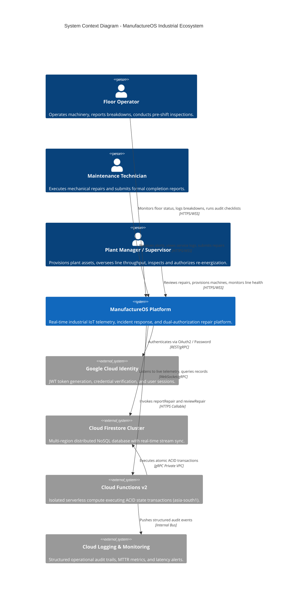
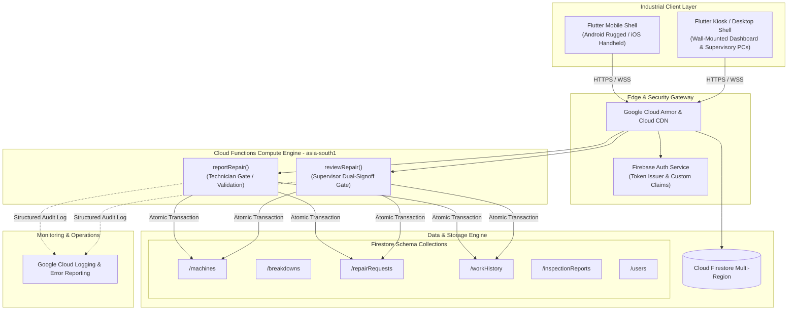
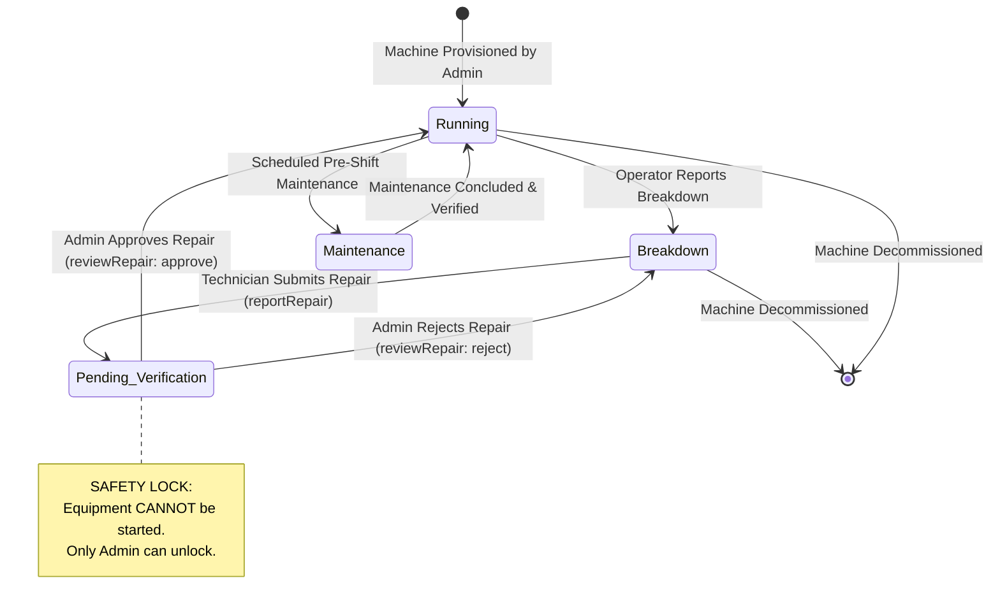
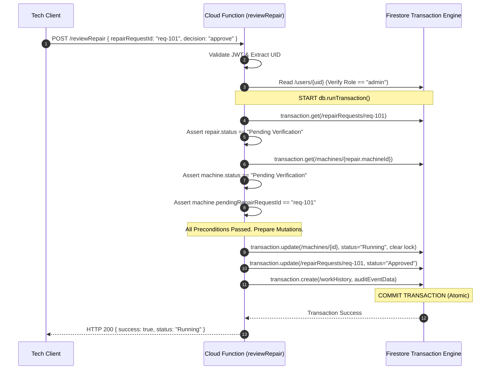

# High-Level Design Document (HLD)
## ManufactureOS: Distributed Industrial Floor Telemetry & Incident Operations Architecture

---

### Document Control & Metadata
- **Document Version:** 1.0.0-PROD
- **Author:** Senior Staff Systems Engineer & Infrastructure Architecture Group
- **Status:** Approved / Production Baseline
- **Classification:** Highly Confidential — Internal Engineering Standard
- **System Tier:** Tier-1 Industrial Mission-Critical Platform

---

## 1. Architectural Principles & Philosophy

ManufactureOS is engineered around five non-negotiable core systems principles:

1. **Boring, Battle-Tested Technology:** In industrial automation, reliability overrides novelty. We default to rock-solid infrastructure: Flutter for deterministic multi-platform rendering across ruggedized hardware, Cloud Firestore for ACID transactional document storage and real-time WebSocket multiplexing, and Node.js Google Cloud Functions v2 for serverless transactional computation.
2. **Stateless by Default, Centralized Truth:** All clients are stateless projection engines. Operational state resides in Firestore with local SQLite offline caching. Device crashes, power cuts, or physical hardware destruction result in zero state loss.
3. **Fail-Closed Industrial Safety:** Any ambiguous state, missing claim, unverified profile, or network partition must default to the safe, locked state: `Breakdown` or `Pending Verification`. Machines can never transition to `Running` via optimistic client execution.
4. **Loud, Explicit Failures:** Exceptions are never swallowed silently. All validation violations, transactional aborts, and permission breaches throw explicit, typed errors (`HttpsError`) with structured telemetry logged to Google Cloud Logging.
5. **Data Isolation & Code for Deletion:** Each operational domain (`machines`, `breakdowns`, `repairRequests`, `workHistory`, `inspectionReports`) operates with distinct collections, schemas, and security boundaries. Domains can be audited, pruned, or refactored without cascading system rewrites.

---

## 2. System Architecture (C4 Model)

### 2.1 Level 1: System Context Diagram


---

### 2.2 Level 2: Container Diagram


---

## 3. Industrial State Machine Architecture

The machine lifecycle is governed by a deterministic, finite state machine (FSM). Arbitrary state transitions are physically impossible; every transition is guarded by pre-conditions, role checks, and atomic database assertions.



### 3.1 State Transition Matrix & Guard Rules

| From State | To State | Trigger / Action | Allowed Role | Guard Pre-conditions |
| :--- | :--- | :--- | :--- | :--- |
| *None* | `Running` | Asset Provisioning (`add_machine_screen`) | `admin` | Unique `machineId`, valid `lineName`. |
| `Running` | `Breakdown` | Operator Reports Fault (`breakdown_form`) | `user` / `admin` | Machine exists, reason $\le 1000$ chars. |
| `Breakdown` | `Pending Verification` | Technician Reports Work (`reportRepair`) | `user` (Technician) | Machine status strictly `Breakdown`. |
| `Pending Verification`| `Running` | Supervisor Sign-off (`reviewRepair: approve`) | `admin` | `machine.pendingRepairRequestId == req.id`. |
| `Pending Verification`| `Breakdown` | Supervisor Rejection (`reviewRepair: reject`) | `admin` | Mandatory review notes detailing failure. |
| `Running` | `Maintenance` | Routine Maintenance Flagged | `admin` | Planned maintenance schedule active. |
| `Maintenance` | `Running` | Maintenance Cleared | `admin` | Checklist passed 100%. |

---

## 4. Transaction Isolation & Concurrency Model

In high-concurrency manufacturing plants, multiple technicians or supervisors may access the same machine simultaneously. ManufactureOS prevents race conditions through **Firestore ACID document transactions** with optimistic concurrency control and strict row-locking equivalents.

### 4.1 Sequence: Dual-Authorization Transactional Flow


### 4.2 Split-Brain & Concurrency Hazard Mitigation
- **Hazard 1: Concurrent Double Review:** Two supervisors tap "Approve" at the same instant on separate tablets.
  - *Resolution:* Firestore's transactional read-set validation detects that the second transaction's snapshot is stale (`status` changed from `Pending Verification` to `Approved`). The second transaction re-reads, fails the precondition assertion, and throws `failed-precondition: This repair request has already been reviewed`.
- **Hazard 2: Phantom Repair on Repaired Unit:** A technician attempts to submit repair notes on a machine that another tech already submitted.
  - *Resolution:* `reportRepair` transaction reads `machine.status`. If it is no longer `Breakdown`, the transaction aborts with `failed-precondition: Only machines in Breakdown status can be reported as repaired`.

---

## 5. Security Architecture & Threat Modeling

```
+---------------------------------------------------------------------------------+
|                       MANUFACTUREOS DEFENSE-IN-DEPTH                            |
+---------------------------------------------------------------------------------+
|  [ Layer 1: Client Gateway ]    UI Role Scoping (Conditional View Rendering)    |
|  [ Layer 2: Network & CDN ]     TLS 1.3 Strict, DDoS Mitigation, Cloud Armor    |
|  [ Layer 3: Identity & Auth ]   Firebase Auth, JWT Bearer Token, Secure Storage |
|  [ Layer 4: Compute Boundary ]  Cloud Functions v2, Input Sanitization, RBAC    |
|  [ Layer 5: Data Security ]     Firestore Security Rules, Transaction Assertions|
|  [ Layer 6: Audit & Forensic ]  Immutable Append-Only Work History Ledger       |
+---------------------------------------------------------------------------------+
```

### 5.1 Role-Based Access Control (RBAC) Matrix

| Resource / Action | Operator (`user`) | Technician (`user`) | Supervisor (`admin`) | Security Enforcement Layer |
| :--- | :---: | :---: | :---: | :--- |
| View Telemetry & Lines | Read | Read | Read | Firestore Security Rules (`request.auth != null`) |
| Report Breakdown | Create | Create | Create | Firestore Rules + Schema Validation |
| Submit Shift Inspection | Create | Create | Create | Firestore Rules (`inspectionReports`) |
| Submit Repair Work Order | Blocked | Execute | Blocked | Cloud Function `reportRepair` (Role == `user`) |
| Approve / Reject Repair | Blocked | Blocked | Execute | Cloud Function `reviewRepair` (Role == `admin`) |
| Provision New Machine | Blocked | Blocked | Execute | Firestore Rules (`users[uid].role == 'admin'`) |
| Modify User Roles | Blocked | Blocked | Execute | Firestore Admin SDK / Cloud IAM |
| Delete Work History | **DENIED** | **DENIED** | **DENIED** | Immutable: Rules deny `delete` to all users |

---

## 6. Network Topology & Deployment Specifications

### 6.1 Region & Compute Placement
- **Primary Cloud Region:** `asia-south1` (Mumbai, India) — Chosen for sub-30ms round-trip latency to manufacturing clusters across the subcontinent.
- **Compute Architecture:** Node.js 20 Cloud Functions v2 with `maxInstances: 10` per function to protect downstream Firestore throughput while providing automated autoscaling.
- **Database Topology:** Cloud Firestore in Datastore mode multi-region active-active cluster with automatic 3-zone synchronous replication.

### 6.2 Offline Data Sync & Client Persistence
- The Flutter client utilizes Firestore's built-in offline persistent cache (`Settings(persistenceEnabled: true)`).
- **Read Path (Offline):** When a forklift driver drives into a shielded metal enclosure or basement without Wi-Fi, the client serves cached line and machine snapshots seamlessly from the local SQLite store.
- **Write Path (Offline):** Breakdown tickets are queued locally with optimistic client IDs and flushed automatically upon reconnection.
- **Safety Critical Operations:** Work order approvals require real-time server connectivity; `reviewRepair` and `reportRepair` are strictly online callable operations that fail-closed if network connectivity is absent.

---

## 7. Observability, Telemetry & Audit Trails

### 7.1 Structured Logging Architecture
Every Cloud Function logs JSON-structured event payloads ingested by Google Cloud Logging:
```json
{
  "severity": "INFO",
  "message": "Repair reviewed",
  "repairRequestId": "req_88492041",
  "decision": "approve",
  "adminId": "usr_super_09",
  "machineId": "CNC_MILL_04",
  "durationMs": 142,
  "timestamp": "2026-10-27T11:45:00.124Z"
}
```

### 7.2 System Health & SLA Metrics
- **Synthetic Availability Monitors:** Automated 60-second health check pings validating Firestore gRPC stream responsiveness and Cloud Function cold-start latency.
- **Error Budget:** Monthly unplanned downtime threshold is 21.6 minutes (99.95% SLA). Any deployment causing > 5 minutes of downtime triggers an automated rollback to the previous stable release tag.
