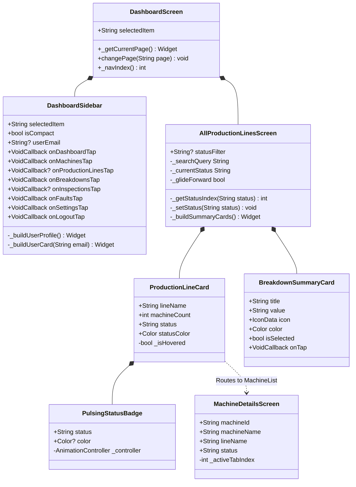

# Low-Level Design Document (LLD)
## ManufactureOS: Code Architecture, Data Schemas, Callable APIs, and Algorithms

---

### Document Control & Metadata
- **Document Version:** 1.0.0-PROD
- **Author:** Senior Staff Systems Engineer & Client Architecture Group
- **Status:** Approved / Production Baseline
- **Classification:** Highly Confidential — Internal Engineering Standard
- **Codebase Path:** `/kalvium/manufacturing_app`

---

## 1. Class & Component Hierarchy

ManufactureOS follows a strictly decoupled, unidirectional data flow architecture. UI widgets consume reactive streams from Cloud Firestore and dispatch mutations through atomic transactions or validated Cloud Functions.



---

## 2. Complete Data Dictionary & Firestore Schemas

### 2.1 Collection: `/machines/{machineId}`
Maintains the master record and live operational status of each piece of equipment.

| Field Name | Type | Nullable | Description / Constraints |
| :--- | :--- | :---: | :--- |
| `machineId` | `String` | No | Unique alphanumeric asset identifier (e.g., `CNC-MILL-01`, `PRESS-B-04`). Primary document ID. |
| `machineName` | `String` | No | Human-readable equipment title (e.g., `5-Axis CNC Milling Center`). |
| `lineName` | `String` | No | Work cell or line name (e.g., `Assembly Line 1`, `Stamping Cell B`). |
| `status` | `String` | No | Enum: `Running`, `Breakdown`, `Maintenance`, `Pending Verification`. |
| `pendingRepairRequestId` | `String` | Yes | Foreign key to active `/repairRequests/{id}` when awaiting supervisor signoff. Cleared upon review. |
| `createdAt` | `Timestamp` | No | Server timestamp of initial asset provisioning. |
| `updatedAt` | `Timestamp` | Yes | Server timestamp of the latest state mutation. |
| `lastFixedBy` | `String` | Yes | UID of technician who executed the latest approved repair. |
| `lastFixedByEmail` | `String` | Yes | Email address of the technician who executed the latest repair. |
| `lastFixedAt` | `Timestamp` | Yes | Timestamp of technician repair submission. |
| `verifiedBy` | `String` | Yes | UID of supervisor who authorized re-commissioning. |
| `verifiedByEmail`| `String` | Yes | Email address of supervisor who authorized re-commissioning. |
| `verifiedAt` | `Timestamp` | Yes | Timestamp of supervisor verification signoff. |

```json
{
  "machineId": "LATHE-02",
  "machineName": "High Precision CNC Lathe",
  "lineName": "Fabrication Cell 1",
  "status": "Running",
  "createdAt": "2026-09-15T08:00:00Z",
  "updatedAt": "2026-10-26T14:30:00Z",
  "lastFixedBy": "tech_user_441",
  "lastFixedByEmail": "dheer.tech@manufactureos.local",
  "lastFixedAt": "2026-10-26T14:15:00Z",
  "verifiedBy": "admin_user_009",
  "verifiedByEmail": "supervisor@manufactureos.local",
  "verifiedAt": "2026-10-26T14:30:00Z"
}
```

---

### 2.2 Collection: `/breakdowns/{breakdownId}`
Immutable event log of reported equipment failures and stoppage tickets.

| Field Name | Type | Nullable | Description / Constraints |
| :--- | :--- | :---: | :--- |
| `machineId` | `String` | No | Reference to target equipment. |
| `machineName` | `String` | No | Cached snapshot of machine name at time of breakdown. |
| `lineName` | `String` | No | Cached snapshot of production line at time of breakdown. |
| `issue` | `String` | No | Root failure description entered by operator ($\le 1000$ chars). |
| `severity` | `String` | No | Enum: `Low`, `Medium`, `High`, `Critical`. |
| `status` | `String` | No | Enum: `Open`, `In Progress`, `Resolved`. |
| `reportedBy` | `String` | No | Email address or UID of operator who logged the incident. |
| `createdAt` | `Timestamp` | No | Server timestamp of breakdown event creation. |

---

### 2.3 Collection: `/repairRequests/{repairRequestId}`
Active dual-authorization work order instances awaiting administrative verification.

| Field Name | Type | Nullable | Description / Constraints |
| :--- | :--- | :---: | :--- |
| `machineId` | `String` | No | Reference to broken equipment. |
| `machineName` | `String` | No | Cached name of equipment. |
| `employeeId` | `String` | No | Firebase Auth UID of technician who completed repair. |
| `employeeEmail`| `String` | No | Email address of technician. |
| `notes` | `String` | No | Detailed repair notes, components replaced, tests conducted ($\le 2000$ chars). |
| `previousStatus`| `String` | No | Machine status prior to repair (`Breakdown`). |
| `status` | `String` | No | Enum: `Pending Verification`, `Approved`, `Rejected`. |
| `decision` | `String` | Yes | Enum: `approve`, `reject`. Populated upon supervisor review. |
| `reviewedBy` | `String` | Yes | UID of supervisor who executed review. |
| `reviewedByEmail`| `String`| Yes | Email address of reviewing supervisor. |
| `reviewNotes` | `String` | Yes | Mandatory corrective action feedback if rejected ($\le 2000$ chars). |
| `createdAt` | `Timestamp` | No | Server timestamp of technician repair submission. |
| `reviewedAt` | `Timestamp` | Yes | Server timestamp of supervisor signoff. |

---

### 2.4 Collection: `/workHistory/{historyId}`
Immutable, append-only forensic audit ledger recording all physical maintenance actions.

| Field Name | Type | Nullable | Description / Constraints |
| :--- | :--- | :---: | :--- |
| `machineId` | `String` | No | Target machine asset ID. |
| `machineName` | `String` | No | Name of machine. |
| `action` | `String` | No | Enum: `repair_submitted`, `repair_approved`, `repair_rejected`, `maintenance_logged`. |
| `previousStatus`| `String` | No | Status before action. |
| `newStatus` | `String` | No | Status resulting from action. |
| `employeeId` | `String` | Yes | UID of technician involved. |
| `employeeEmail`| `String` | Yes | Email of technician. |
| `reviewedBy` | `String` | Yes | UID of supervisor involved. |
| `reviewedByEmail`| `String`| Yes | Email of supervisor. |
| `repairRequestId`| `String`| Yes | Linked repair request ID. |
| `notes` | `String` | Yes | Work notes or supervisor rejection remarks. |
| `createdAt` | `Timestamp` | No | Server timestamp of audit record. |

---

### 2.5 Collection: `/inspectionReports/{reportId}`
Shift-level quality, safety, and operational readiness checklists.

| Field Name | Type | Nullable | Description / Constraints |
| :--- | :--- | :---: | :--- |
| `machineId` | `String` | No | Machine inspected. |
| `machineName` | `String` | No | Name of machine inspected. |
| `result` | `String` | No | Enum: `Passed`, `Needs Attention`, `Failed`. |
| `description` | `String` | No | Checklist item remarks and observations. |
| `inspector` | `String` | No | Email or UID of inspector. |
| `createdAt` | `Timestamp` | No | Server timestamp of inspection submission. |

---

### 2.6 Collection: `/users/{uid}`
User authentication profiles and role claims.

| Field Name | Type | Nullable | Description / Constraints |
| :--- | :--- | :---: | :--- |
| `email` | `String` | No | User corporate email address. |
| `role` | `String` | No | Enum: `admin` (Supervisor/Manager), `user` (Operator/Technician). |
| `displayName` | `String` | Yes | Full name of associate. |
| `createdAt` | `Timestamp` | No | Account provisioning timestamp. |

---

## 3. Cloud Functions Backend API Specifications

All state-critical mutations route through Google Cloud Functions v2 in `asia-south1`.

### 3.1 API: `reportRepair`
- **Trigger:** HTTPS Callable (`onCall`)
- **Authentication:** Mandatory (`request.auth != null`)
- **Role Requirement:** `users/{uid}.role == 'user'`

#### Request Payload
```typescript
interface ReportRepairRequest {
  machineId: string; // Min: 1 char, Max: 128 chars, non-empty
  notes: string;     // Min: 1 char, Max: 2000 chars, non-empty
}
```

#### Response Payload (Success)
```typescript
interface ReportRepairResponse {
  success: true;
  repairRequestId: string;
  status: "Pending Verification";
}
```

#### Error Catalog
| HTTP Code | Error Code | Scenario |
| :---: | :--- | :--- |
| 401 | `unauthenticated` | Missing or invalid Firebase Auth JWT token. |
| 403 | `permission-denied` | User profile role is not `user`, or profile does not exist. |
| 400 | `invalid-argument` | `machineId` or `notes` is missing, empty, or exceeds max length. |
| 404 | `not-found` | Target `machineId` does not exist in `/machines` collection. |
| 412 | `failed-precondition` | Target machine status is not `Breakdown`. |

---

### 3.2 API: `reviewRepair`
- **Trigger:** HTTPS Callable (`onCall`)
- **Authentication:** Mandatory (`request.auth != null`)
- **Role Requirement:** `users/{uid}.role == 'admin'`

#### Request Payload
```typescript
interface ReviewRepairRequest {
  repairRequestId: string;         // Min: 1 char, Max: 128 chars
  decision: "approve" | "reject"; // Strict enum
  notes?: string;                  // Optional, Max: 2000 chars
}
```

#### Response Payload (Success)
```typescript
interface ReviewRepairResponse {
  success: true;
  status: "Running" | "Breakdown";
}
```

#### Error Catalog
| HTTP Code | Error Code | Scenario |
| :---: | :--- | :--- |
| 401 | `unauthenticated` | Missing or invalid Firebase Auth JWT token. |
| 403 | `permission-denied` | User profile role is not `admin`. |
| 400 | `invalid-argument` | Decision is not `approve` or `reject`, or notes $> 2000$ chars. |
| 404 | `not-found` | Repair request or referenced machine does not exist. |
| 412 | `failed-precondition` | Repair request already reviewed, or machine status is not `Pending Verification`. |

---

## 4. Algorithmic Specifications

### 4.1 Algorithm 1: Single-Pass Production Line Health Aggregation
- **Location:** `AllProductionLinesScreen.build` (`lib/screens/all_production_lines_screen.dart`)
- **Complexity:** Time $\mathcal{O}(N)$, Space $\mathcal{O}(U)$ where $N = \text{total machines}$, $U = \text{unique lines}$.
- **Objective:** Compute line operational status deterministically from real-time machine telemetry stream.

```
ALGORITHM AggregateProductionLines(machinesDocs):
  INPUT: List of Machine DocumentSnapshots
  OUTPUT: Map of LineName -> LineHealthSummary

  INITIALIZE lineMap as Map<String, LineAccumulator>

  FOR EACH doc IN machinesDocs:
    data = doc.data()
    lineName = (data['lineName'] ?? data['line'] ?? 'Main Floor').trim()
    status = (data['status'] ?? 'Running').trim()

    IF lineName NOT IN lineMap:
      lineMap[lineName] = LineAccumulator(total=0, running=0, breakdown=0, maintenance=0)

    lineMap[lineName].total += 1
    
    IF status == 'Breakdown':
      lineMap[lineName].breakdown += 1
    ELSE IF status == 'Pending Verification' OR status == 'Maintenance':
      lineMap[lineName].maintenance += 1
    ELSE:
      lineMap[lineName].running += 1

  INITIALIZE resultLines as List<LineInfo>

  FOR EACH (lineName, stats) IN lineMap:
    IF stats.breakdown > 0:
      computedStatus = 'Breakdown'
      statusColor = AppColors.breakdown
    ELSE IF stats.maintenance > 0:
      computedStatus = 'Maintenance'
      statusColor = AppColors.maintenance
    ELSE:
      computedStatus = 'Running'
      statusColor = AppColors.running

    APPEND LineInfo(name: lineName, counts: stats, status: computedStatus, color: statusColor) TO resultLines

  RETURN resultLines
```

---

### 4.2 Algorithm 2: Sliding-Window Recurring Fault Detection
- **Location:** `RecurringFaultsScreen` (`lib/screens/recurring_faults_screen.dart`) & `DashboardHomeContent`
- **Complexity:** Time $\mathcal{O}(B)$, Space $\mathcal{O}(M)$ where $B = \text{breakdowns in window}$, $M = \text{unique machine IDs}$.
- **Objective:** Isolate chronic machine failures that threaten plant uptime.

```
ALGORITHM DetectRecurringFaults(breakdownDocs, windowDays = 30, threshold = 2):
  INPUT: List of Breakdown DocumentSnapshots, windowDays integer, threshold integer
  OUTPUT: List of MachineIDs flagged as Recurring Fault Risks

  cutoffTimestamp = CurrentTime - windowDays * 86400 seconds
  INITIALIZE breakdownFrequencyMap as Map<String, int>

  FOR EACH doc IN breakdownDocs:
    data = doc.data()
    machineId = data['machineId']
    createdAt = data['createdAt'].toDate()

    IF createdAt >= cutoffTimestamp AND machineId IS NOT EMPTY:
      breakdownFrequencyMap[machineId] = (breakdownFrequencyMap[machineId] ?? 0) + 1

  INITIALIZE atRiskMachines as List<String>

  FOR EACH (machineId, count) IN breakdownFrequencyMap:
    IF count >= threshold:
      APPEND machineId TO atRiskMachines

  RETURN atRiskMachines
```

---

### 4.3 Algorithm 3: Directional Slide Animation Index Transition
- **Location:** `AllProductionLinesScreen._setStatus` & `AnimatedSwitcher`
- **Objective:** Provide ergonomic spatial feedback when filtering line cards.

```
ALGORITHM ComputeGlideDirection(newStatus, currentStatus):
  STATUS_ORDER = ['All': 0, 'Running': 1, 'Maintenance': 2, 'Breakdown': 3]
  
  newIndex = STATUS_ORDER[newStatus]
  oldIndex = STATUS_ORDER[currentStatus]

  isGlideForward = (newIndex >= oldIndex)

  SET transitionOffsetBegin = isGlideForward ? Offset(0.07, 0.0) : Offset(-0.07, 0.0)
  SET transitionCurve = Curves.easeOutCubic
```

---

## 5. Industrial Ergonomics & Responsive Breakpoints

ManufactureOS deploys across three distinct physical hardware form factors:

```
+---------------------------------------------------------------------------------+
|                         HARDWARE RESPONSIVE STRATEGY                            |
+---------------------------------------------------------------------------------+
|  1. Handheld Rugged Phone    Width < 768px       Bottom Navigation Bar          |
|  2. Tablet / Kiosk Mounted   768px <= W < 1100px Compact Icon-Only Sidebar      |
|  3. Desktop Command Station  Width >= 1100px     Full Expanded Labeled Sidebar  |
+---------------------------------------------------------------------------------+
```

### 5.1 Responsive Code Contract (`lib/utils/responsive.dart`)
```dart
class Responsive {
  static const double mobileBreakpoint = 768;
  static const double tabletBreakpoint = 1100;
  static const double maxContentWidthDesktop = 1280;

  static bool isMobile(BuildContext context) =>
      MediaQuery.of(context).size.width < mobileBreakpoint;

  static bool isTablet(BuildContext context) =>
      MediaQuery.of(context).size.width >= mobileBreakpoint &&
      MediaQuery.of(context).size.width < tabletBreakpoint;

  static bool isDesktop(BuildContext context) =>
      MediaQuery.of(context).size.width >= tabletBreakpoint;
}
```

---

## 6. Verification & Automated Test Matrix

```
+---------------------------------------------------------------------------------+
|                       TEST SUITE HIERARCHY & TARGETS                            |
+---------------------------------------------------------------------------------+
|  [ Unit Tests ]      Responsive breakpoints, MachineDetails safe defaults       |
|  [ Widget Tests ]    PulsingStatusBadge, StatCard, CustomLoadingScreen,         |
|                      BreakdownSummaryCard, ProductionLineCard, DashboardSidebar |
|  [ Golden Tests ]    High-contrast visual validation on Mobile & Desktop        |
|  [ Cloud Tests ]     Transaction rollback, Permission Denied, Race Condition    |
+---------------------------------------------------------------------------------+
```

### 6.1 Executed Automated Test Ledger (`test/widget_test.dart`)
1. `PulsingStatusBadge displays status label and renders correctly` — Validates real-time pulsing color interpolation.
2. `StatCard displays value, title, and responds to tap` — Verifies industrial metric tile interactions.
3. `CustomLoadingScreen displays brand title, message, and loading indicator` — Validates telemetry bootstrap visual.
4. `Responsive breakpoint logic functions correctly` — Asserts 768px / 1100px boundary conditions.
5. `BreakdownSummaryCard renders inspection summary metrics and handles selection` — Tests active filter chip toggles.
6. `ProductionLineCard renders line name, machine count, and status badge` — Asserts exact string formatting (`5 Machines`).
7. `DashboardSidebar renders Production Lines menu item and handles tap` — Verifies scrollable menu tap routing without throwing unmocked Firebase exceptions.
8. `MachineDetailsScreen constructor has safe defaults` — Validates null-safe fallback parameters.
