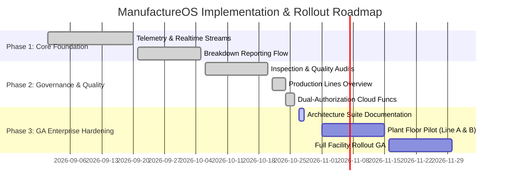

# Product Requirements Document (PRD)
## ManufactureOS: Industrial Telemetry, Equipment Health, and Incident Management Platform

---

### Document Control & Metadata
- **Document Version:** 1.0.0-PROD
- **Author:** Senior Staff Systems Engineer & Product Architecture Group
- **Status:** Approved / Production Target
- **Classification:** Highly Confidential — Internal Engineering Standard
- **Target Release:** Q1 ManufactureOS Platform GA

---

## 1. Executive Summary & Problem Space

### 1.1 Problem Statement
Modern high-throughput manufacturing facilities experience catastrophic operational losses due to fragmented shop-floor communications, unmonitored equipment degradation, and paper-based or siloed maintenance processes. 

According to industrial benchmarks, unplanned factory downtime costs industrial plants an average of **\$260,000 per hour**. The core vulnerabilities identified across shop floors include:
1. **High Latency Incident Escalation:** Machine operators discover equipment anomalies or breakdowns, but reliance on manual verbal or paper notifications creates a 25–45 minute escalation lag before maintenance technicians are dispatched.
2. **Safety-Critical Startup Hazards:** Repaired equipment is frequently re-energized without formal safety and engineering sign-off, resulting in OSHA compliance violations, catastrophic secondary failures, and worker safety risks.
3. **Invisible Production Cell Bottlenecks:** Plant managers and shift leads lack real-time visibility into line-level machine health aggregation. While individual machines may appear operational, line-level degradation creates hidden throughput throttling.
4. **Lack of Auditable Quality Records:** Regulatory compliance (ISO 9001, IATF 16949) mandates immutable records of daily pre-shift inspections, maintenance actions, and safety sign-offs. Siloed clipboards create gaps in legal liability and warranty claims.

### 1.2 Product Vision
**ManufactureOS** is a mission-critical, real-time shop-floor operating system designed for industrial manufacturing plants. It bridges the gap between hardware telemetry, floor operators, field technicians, and plant management. 

By unifying equipment inventory, production line cell monitoring, dual-authorization repair workflows, and plant-wide audit logging into a resilient, cross-platform architecture, ManufactureOS eliminates uncoordinated maintenance, guarantees safety verification before equipment re-energization, and optimizes Overall Equipment Effectiveness (OEE).

---

## 2. Business Value & Success Metrics (KPIs)

| Metric | Baseline (Legacy Process) | ManufactureOS Target | Measurement Methodology |
| :--- | :--- | :--- | :--- |
| **MTTR (Mean Time to Repair)** | 148 Minutes | **< 65 Minutes (-56%)** | Timestamp delta: `breakdown.createdAt` to `repairRequest.reviewedAt` (approved). |
| **Escalation Latency** | 32 Minutes | **< 60 Seconds** | Delta between physical stoppage and digital incident broadcast to technician feeds. |
| **Unauthorized Restarts** | 4.2 incidents / month | **Zero (0) Incidents** | Strict dual-authorization state machine lock enforced via server-side transactions. |
| **OEE (Overall Equipment Effectiveness)**| 64.8% | **> 82.5%** | Aggregate availability, performance efficiency, and quality rate. |
| **Pre-Shift Inspection Compliance** | 71.4% completed | **> 99.2% digital audits** | Daily submitted digital checklists in `inspectionReports` collection. |
| **Recurring Breakdown Rate** | 18.2% of tickets | **< 5.0% repeat failures** | Algorithmic recurring fault detection flagging 2+ breakdowns within 30-day window. |

---

## 3. Target User Personas & Permissions

```
+-----------------------------------------------------------------------------------+
|                              MANUFACTUREOS USER ROLES                             |
+-----------------------------------------------------------------------------------+
|                                                                                   |
|  [ Operator ]               [ Maintenance Technician ]     [ Plant Admin / Lead ] |
|  - Floor equipment operator - Certified repair technician  - Plant manager        |
|  - Log machine breakdowns   - Execute work orders          - Shift supervisor     |
|  - Run shift inspections    - Submit repair completion     - Authorize restarts   |
|  - View live cell status    - View equipment fault history - Provision machinery  |
|                                                                                   |
+-----------------------------------------------------------------------------------+
```

### 3.1 Operator (Floor Associate)
- **Role Code:** `user`
- **Primary Environment:** Ruggedized Android tablets, shared floor kiosks, wall-mounted touchscreens.
- **Responsibilities:** Monitor active machine operating status, conduct pre-shift safety checklists, report emergency breakdowns immediately upon anomaly detection.
- **Pain Points:** Clunky software with tiny touch targets; complex forms that interrupt physical throughput; delayed response from dispatch.

### 3.2 Maintenance Technician (Field Engineer)
- **Role Code:** `user` (with technician specialization)
- **Primary Environment:** Mobile devices (iOS/Android), wearable scanners, tablets.
- **Responsibilities:** Receive real-time breakdown alerts, diagnose root causes, execute mechanical/electrical repairs, log work notes, and submit completed repairs for formal verification.
- **Pain Points:** Unclear incident descriptions, missing machine service history, inability to prove work done to shift supervisors.

### 3.3 Plant Administrator (Shift Supervisor / Plant Manager)
- **Role Code:** `admin`
- **Primary Environment:** Desktop workstations, supervisory tablets.
- **Responsibilities:** Provision new industrial machinery, assign equipment to production lines, perform engineering reviews on submitted repairs, authorize machine re-commissioning, manage worker roles.
- **Pain Points:** Lack of audit trails during safety audits, accidental re-energization of dangerous equipment, absence of high-level cell throughput summaries.

---

## 4. User Journey Maps

### 4.1 Critical Incident & Dual-Authorization Workflow
```mermaid
sequenceDiagram
    autonumber
    actor Operator as Floor Operator
    participant App as ManufactureOS Client
    participant Functions as Cloud Functions (asia-south1)
    participant DB as Cloud Firestore
    actor Admin as Shift Supervisor (Admin)

    Operator->>App: Detects overheating motor, taps "Report Breakdown"
    App->>DB: Write incident record to /breakdowns (Severity: Critical)
    App->>DB: Atomic update /machines/{id} -> status: "Breakdown"
    Note over DB: All connected plant screens update within <200ms
    
    actor Tech as Maintenance Tech
    Tech->>App: Views active breakdown, dispatches to work cell
    Tech->>Tech: Replaces motor bearings & tests safety lock
    Tech->>App: Submits repair report with work notes
    App->>Functions: reportRepair(machineId, notes)
    Functions->>DB: Transaction: set status="Pending Verification", record repairRequest
    Note over DB: Machine CANNOT be started by floor operators
    
    Admin->>App: Receives "Pending Verification" notification
    Admin->>Admin: Physical inspect & review electrical logs
    Admin->>App: Submits "Approve & Re-energize"
    App->>Functions: reviewRepair(repairRequestId, "approve", notes)
    Functions->>DB: Atomic Transaction: status="Running", clear pending lock, record /workHistory
    Note over DB: Machine unlocked; Line health updates to Running
```

---

## 5. Functional Requirements (Epics & Features)

### Epic 1: Plant-Wide Production Lines & Work Cells Grid
- **Priority:** Must Have (P0)
- **Goal:** Provide macro-level visibility into manufacturing lines, aggregating individual machine health into line-level operational statuses.

#### Requirements:
- **FR-1.1 Line Telemetry Aggregation:** The system shall aggregate all machines by their associated `lineName` (with legacy fallback to `line` and default `'Main Floor'`).
- **FR-1.2 Deterministic Line Status Matrix:**
  - If $\ge 1$ machine on the line is in `Breakdown` status $\rightarrow$ Line status is **Breakdown** (`AppColors.breakdown`).
  - If no machines are in `Breakdown`, but $\ge 1$ machine is in `Pending Verification` or `Maintenance` $\rightarrow$ Line status is **Maintenance** (`AppColors.maintenance`).
  - If 100% of machines are in `Running` status $\rightarrow$ Line status is **Running** (`AppColors.running`).
- **FR-1.3 KPI Summary Strip:** Real-time counters displaying Total Lines, Running Lines, Maintenance Lines, and Breakdown Lines. Tapping any metric card filters the line feed dynamically.
- **FR-1.4 Directional Glide Transition:** The filtered list shall animate with directional slide transitions (`AnimatedSwitcher` + `Curves.easeOutCubic`) indicating relative index position.
- **FR-1.5 1-Tap Cell Drilldown:** Tapping any line card shall immediately open `MachineListScreen` scoped exclusively to that production line's machinery.

### Epic 2: Industrial Machinery Management & Real-Time Telemetry
- **Priority:** Must Have (P0)
- **Goal:** Complete lifecycle registry of plant assets with live operational metrics.

#### Requirements:
- **FR-2.1 Asset Registration:** Administrators can provision new machines specifying `machineId` (unique alphanumeric tag), `machineName`, `lineName`, and initial status.
- **FR-2.2 Real-time Telemetry Stream:** Machine list and details screens must bind to Firestore real-time snapshot streams with zero manual pull-to-refresh requirement.
- **FR-2.3 Industrial Status Indicators:** Every machine card must display high-visibility typography, operational status badges, and pulsing visual indicators (`PulsingStatusBadge`) for at-a-glance shop floor visibility.
- **FR-2.4 Machine Service History:** Each machine detail screen must present historical maintenance events, inspection logs, and recurring fault alerts in isolated tabs.

### Epic 3: Emergency Breakdown Reporting & Incident Dispatch
- **Priority:** Must Have (P0)
- **Goal:** Enable rapid incident reporting with sub-minute alert propagation.

#### Requirements:
- **FR-3.1 3-Click Incident Submission:** An operator must be able to log a breakdown within 3 taps: Select Machine $\rightarrow$ Pick Severity / Fault Description $\rightarrow$ Submit.
- **FR-3.2 Real-Time Floor Broadcast:** Submitting a breakdown atomically transitions the machine document to `Breakdown` status, immediately propagating crimson alerts across all connected dashboards.
- **FR-3.3 Incident Queue:** A dedicated `AllBreakdownsScreen` displays open tickets sorted by severity and recency, enabling maintenance dispatchers to prioritize critical line stoppages.

### Epic 4: Dual-Authorization Work Order & Repair Lifecycle
- **Priority:** Must Have (P0)
- **Goal:** Enforce strict industrial safety protocols preventing unauthorized machine operation following maintenance.

#### Requirements:
- **FR-4.1 Technician Submission Gate:**
  - Cloud Function: `reportRepair`
  - Restricts submission exclusively to verified users with role `user`.
  - Enforces prerequisite: Target machine must currently be in `Breakdown` status.
  - State Mutation: Atomically changes machine status to `Pending Verification` and writes an immutable `repairRequests` document.
- **FR-4.2 Supervisor Verification Gate:**
  - Cloud Function: `reviewRepair`
  - Restricts execution exclusively to users with role `admin`.
  - Enforces prerequisite: Target repair request and machine must be in `Pending Verification` status.
  - Decision Logic:
    - **Approve:** Machine status transitions to `Running`. Records `lastFixedBy`, `verifiedBy`, and timestamp metadata.
    - **Reject:** Machine status reverts to `Breakdown`. Supervisor must enter mandatory corrective action notes.
  - Full audit event appended to `workHistory`.

### Epic 5: Pre-Shift Inspection & Quality Audit Logs
- **Priority:** Should Have (P1)
- **Goal:** Digitize daily OSHA/ISO compliance checklists with instant supervisor auditing.

#### Requirements:
- **FR-5.1 Checklist Execution:** Operators execute safety checklists (emergency stop check, oil pressure, thermal scans, guard alignment) scoring each unit as `Passed`, `Needs Attention`, or `Failed`.
- **FR-5.2 Centralized Audit Stream:** `AllInspectionsScreen` aggregates plant-wide inspection reports with real-time status counters, inspector email metadata, and date filtering.
- **FR-5.3 1-Click Asset Navigation:** Tapping any audit item in the inspection log routes directly to `MachineDetailsScreen` with pre-populated contextual metadata.

### Epic 6: Algorithmic Recurring Fault & Degradation Analytics
- **Priority:** Should Have (P1)
- **Goal:** Eliminate chronic equipment breakdowns through automated pattern recognition.

#### Requirements:
- **FR-6.1 Frequency Thresholding:** The system computes historical breakdown counts per machine across a rolling 30-day window. Machines with $\ge 2$ breakdown events are automatically classified as `Recurring Fault Risk`.
- **FR-6.2 Dashboard Warning Banner:** When recurring faults are detected, an amber warning alert (`Warning: N Machine(s) with Recurring Faults`) renders directly on the primary dashboard with a 1-tap route to `RecurringFaultsScreen`.

---

## 6. Non-Functional Requirements (NFRs)

### 6.1 Performance & Latency
- **NFR-1 Latency SLA:** UI updates from real-time snapshot events must render within $\le 100\text{ms}$ on Android and iOS devices.
- **NFR-2 Cloud Function Execution:** Cloud Functions (`reportRepair`, `reviewRepair`) must complete execution within $\le 800\text{ms}$ at P95 (region `asia-south1`).
- **NFR-3 Startup Time:** Cold launch to usable interactive dashboard $\le 1.8\text{ seconds}$ on standard industrial tablets.

### 6.2 Availability & Resilience
- **NFR-4 Platform Uptime:** 99.95% availability for backend APIs and real-time database feeds.
- **NFR-5 Offline Resilience:** Local Firestore offline persistence must cache all machine and line telemetry so operators can inspect equipment details even during transient Wi-Fi dead-zones in factory basements.
- **NFR-6 Reconnection Reconciliation:** Client state must automatically synchronize with the central cluster within 5 seconds of reconnecting to network.

### 6.3 Security & Compliance
- **NFR-7 Fail-Closed RBAC:** Authorization checks must occur at every boundary. Client-side hiding of buttons is purely cosmetic; Cloud Functions and Firestore Security Rules must strictly reject unauthorized mutations.
- **NFR-8 Principle of Least Privilege:** Users cannot write directly to `workHistory` or `repairRequests`. All state mutations in the repair lifecycle must route through transactional Cloud Functions.
- **NFR-9 Data Integrity & Audit Trail:** Work history events must be append-only. No user or admin is permitted to delete historical maintenance records.

### 6.4 Ergonomics & Industrial Usability
- **NFR-10 Touch Target Sizing:** All clickable UI elements (buttons, cards, chips) must have a minimum interactive bounding box of $48 \times 48\text{ dp}$ to facilitate operation by personnel wearing industrial safety gloves.
- **NFR-11 Visual Contrast (ISO/IEC Standards):** All text and status badges must meet WCAG AAA contrast ratio ($\ge 7:1$) against dark and light backgrounds for legibility under high-glare metal halide factory floor lighting.
- **NFR-12 Responsive Shell:** The application must natively adapt between small handheld smartphones (bottom navigation bar) and large mounted tablets/desktop terminals (collapsible sidebar with scrollable navigation).

---

## 7. Edge Cases & Risk Analysis

| Edge Case / Threat | Failure Consequence | Mitigation Strategy |
| :--- | :--- | :--- |
| **Network disconnect during repair submission** | Technician thinks repair is submitted, but server never received it. | Optimistic UI feedback disabled for repairs; functions return explicit server acknowledgement; local spinner locks until server ack. |
| **Simultaneous approval by two supervisors** | Race condition; duplicate history entries; corrupted verification states. | Firestore atomic transactions (`db.runTransaction`) with document lock and state assertion (`status === 'Pending Verification'`). Second write aborts cleanly. |
| **App crash during shift inspection** | Operator loses partially completed 20-item checklist. | In-memory draft persistence backed by reactive form controllers; auto-save checklist progress. |
| **Attempt to report repair on already running machine** | Invalid state machine transition; phantom audit logs. | Pre-condition assertion in Cloud Function: target machine must be in `Breakdown` status before repair can be filed. |
| **Device rotation / screen resize in split view** | RenderFlex overflow; clipping critical status buttons. | Comprehensive `LayoutBuilder`, `SingleChildScrollView`, and `Responsive` utility wrapping all dynamic menus and grids. |

---

## 8. Release Roadmap & Phase Gates


